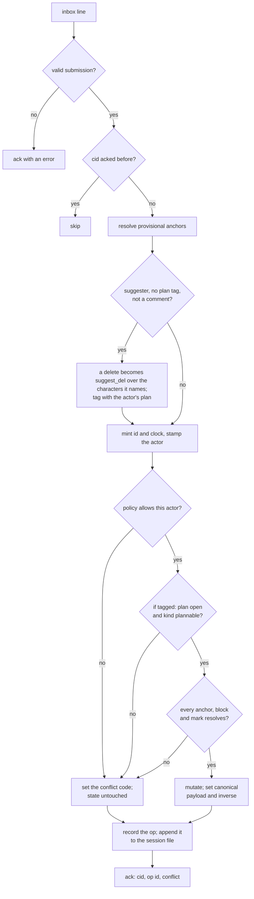
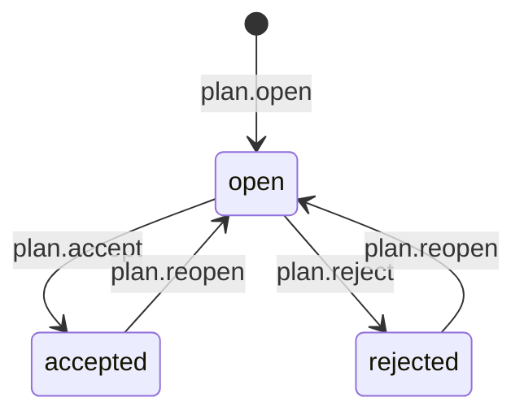

# Concurrency and version control

Three parties edit one document: a person, a coding agent, and codoc's loop. This file
says who may write, in what order ops apply, what happens when two writes meet, how a
suggestion becomes text, and how the log lives in git. The state and the ops themselves
are defined in [model.md](model.md).

## 1. Processes

One process applies ops at a time. It is called the applier.

| process | inbox name | how it writes |
|---|---|---|
| the daemon (`codoc watch`) | | It is the applier. It also runs the loop. |
| the editor host | `ide` | Appends submissions to its inbox file. |
| the CLI | `cli` | Inbox when a daemon is alive; applies directly when none is. |
| the MCP server (the coding agent) | `mcp` | Same as the CLI. |
| the hub, per signed-in user | `hub-<login>` | Appends submissions to that user's inbox file. |

- A daemon is alive when `.codoc/watch.pid` names a running process. A second daemon
  refuses to start.
- A daemon builds its store, writes the pidfile, then rebuilds the store once under the
  applier lock. A daemonless writer that applied before that is in the logs it reads.
  A writer that saw no daemon and got the lock after the pidfile was written checks for
  a daemon again under the lock and submits through the inbox instead.
- Every client submission, applied directly or drained from an inbox, goes through
  `Workspace.apply_submission`: what a client may assert, how a suggester's edit becomes
  a plan, and what an amend or an ingest answers are decided there.
- With a daemon alive, no other process applies. A writer appends to
  `.codoc/inbox/<client>.jsonl` and reads the answer from `.codoc/inbox/<client>.ack.jsonl`.
- With no daemon, a writer is the applier for one call. It takes an exclusive lock on
  `.codoc/applier.lock`. If `HEAD` moved since its last turn it rebuilds and starts a new
  session, as the daemon does; otherwise it rebuilds only if a log file other than its
  own session's changed size. Then it applies, publishes the derived files, and releases
  the lock.
- The lock is held per call. Held for the life of a process, it would leave every other
  writer submitting to an inbox that no daemon drains. `codoc translate` and
  `codoc rebuild` hold it for their whole run and refuse while a daemon is alive.
- A long-lived writer with no daemon (the MCP server) keeps one store and one session
  file across calls. Its reads also rebuild when another process's log file changed.
  When a daemon appears, it closes its session and submits through the inbox.

## 2. Files

```
.codoc/
  config.json                  tracked    doc_language, roles
  tree.codoc                   tracked    the Markdown export; derived
  log/<session>.jsonl          tracked    the op log, one file per session
  log/snapshot-<hlc>.jsonl     tracked    a folded prefix of the log
  log/archive/                 tracked    files a snapshot folded
  inbox/<client>.jsonl         ignored    submissions, client to applier
  inbox/<client>.ack.jsonl     ignored    answers, applier to client
  inbox/offsets.json           ignored    how far each inbox file has been drained
  projection.json, history.json, status.json, realize.md      ignored    derived
  activity.json, watch.pid, applier.lock                      ignored    local state
```

A session file:

```
{"header": 1, "session": "s-3f9a…", "opened": <HLC>, "node": "<host>"}
{"id": "s-3f9a…:1", "at": <HLC>, "actor": …, "kind": …, "target": …, "payload": …, …}
…
{"closed": 1}
```

- One op per line, as recorded: canonical payload, inverse, conflict.
- The file is created by the session's first op. A session that writes nothing leaves no file.
- Each op is flushed when written and the file is synced once per batch.
- The `closed` line is written when the writer is done with the file.

A file is checked when it is read:

| check | on failure |
|---|---|
| The first line is a header with a `session`. | The file is reported and skipped whole. |
| Every id is `<session>:<seq>` and `seq` runs 1, 2, 3, … | Reported and skipped whole. |
| Every `at` is a well-formed HLC and never decreases. | Reported and skipped whole. |
| Every line parses. | Reported and skipped whole, unless only the last line is unreadable. |
| The last line is unreadable (a crash mid-write). | The lines before it are kept. The daemon cuts the torn line at its next start. |

A partial read is never used: it would put the store in a state no log describes.

## 3. Clock

`HLC := "<wall ms, 20 digits>-<logical, 20 digits>-<node>"`. String order is the total order.

- `tick`: when the wall clock is ahead of the last stamp, take it with logical 0;
  otherwise keep the wall part and add 1 to the logical part.
- `observe(stamp)`: move forward to any stamp seen during replay.
- Only the applier stamps `at`. A submission carries none.
- A peer's fast clock therefore moves this clock forward. An op written after a pull is
  later than every character it can anchor to.

## 4. A submission's path

A submission is one JSON line:

```
{ cid, kind, target, payload, batch?, plan?, base?, caused_by? }
```

`cid` is the client's own id for it. `kind` is an op kind, or `ingest` with
`target: {bid, path}` and `payload: {base_text, new_md}`. A client appends a batch with
one write, so concurrent writers interleave whole lines.

The inbox file name decides the actor:

| inbox file | actor |
|---|---|
| `ide.jsonl`, `cli.jsonl` | `human:local` |
| `mcp.jsonl` | `agent:claude-code` |
| `hub-<login>.jsonl` | `human:gh:<login>` |
| any other name | ignored; nothing is applied |

The `gh:` prefix keeps a GitHub login named `local` or `import` from arriving as the
maintainer's identity.

The drain, per client, per line:

1. Read the complete lines after the remembered byte offset. An unterminated last line
   waits for the next drain.
2. A line that is not a valid submission is acked with an error.
3. A `cid` already acked is skipped: no op, no second ack.
4. `caused_by` is dropped unless the actor is a machine.
5. Provisional anchors are resolved (below).
6. For an actor with the `suggest` role and no plan tag: a range `text.delete` becomes a
   `suggest_del` mark over the same range, unless every character in the range was minted
   by an open plan of that actor. Any plannable op that is not part of a comment is then
   tagged with a plan of that actor, opened or reused by the drain (section 9).
7. An `ingest` runs the diff in the applier and goes through the machine gate
   (section 7). Any other kind is minted (next `seq`, `tick`, actor) and applied.
8. The recorded op is appended to the session file.
9. The ack is written: `{cid, op, conflict}`. For an ingest, `op` is the first op it
   minted, `conflict` is the refusal if there was one, and `status: "unchanged"` marks a
   write that asked for nothing.
10. The offset moves past the line.

After a client's lines, every plan the drain opened that has no ops is withdrawn. A
submission that raises is acked `refused: …` and the drain continues with the next line.



**Provisional anchors.** A client cannot know the op id of characters it sent a moment
ago. It may name them as `["$cid", "<cid>", k]`: the `k`-th character of the insert it
submitted as `cid`. The drain resolves these against the acks it has given that client.
`k` is the client's index into the text it sent; the applier stores NFC, so the index is
mapped through the normalisation. An anchor that does not resolve is left as it is and
the op conflicts `bad_anchor`.

**Idempotency.** An acked `cid` is never applied twice. Ack files are trimmed to their
newest 2000 lines when a session opens, and `offsets.json` keeps the applier from
re-reading lines it has drained.

**The daemon's batch.** File events are debounced (600 ms). For each batch the daemon does, in order:

1. If `HEAD` moved: rebuild the store from the log files now on disk and start a new session.
2. Reload the roles from `config.json`, then drain every inbox from its saved offset.
   This runs on every batch, including the first one at startup and `codoc sync`, so
   submissions written while no daemon ran are applied.
3. Read the agent epoch from `activity.json`. While a coding agent's session is open,
   changed code files are held. When it closes, or after 900 seconds of silence, they
   are released to step 4 and that pass may settle hand-offs (section 10).
4. Reflect the changed code files that are not held: the loop's pass, which writes ops as `loop`.
5. Publish the derived files.

## 5. Sessions

- A session is one applier's run between rotations. Its id is random.
- One session file has one writer and many actors: the person, the loop and the agents
  appear in it in the order they wrote.
- The applier (the daemon, or a writer with no daemon) closes its session and opens a new
  one when `HEAD` moves (a commit, a checkout, a pull, a rebase). The daemon also closes
  it when it exits.
- `HEAD` is checked at the start of each daemon batch and each daemonless call. A commit
  made while a long pass runs (a reflect pass waiting on a model) is seen at the next
  batch, so that pass's ops still go to the file the commit may have recorded. The next
  commit records them; a merge of two branches is unaffected, because each branch's
  files are its own.
- A read-only open replays the logs and writes nothing.

## 6. Replay

The store is rebuilt from the files on disk. The order is:

1. Read every session file in `log/`. Skip each invalid file whole.
2. If there is a snapshot, replay the newest one first, then add its frontier to the
   store's frontier.
3. Replay every op of the session files that is outside the snapshot's frontier, sorted
   by `(at, session, seq)`.

Each op replays as its record says:

- An op recorded with a conflict is recorded again with that conflict and applied not at all.
- An op recorded as applied is applied from its canonical payload, with the authority
  check off.
- An op recorded as applied that conflicts now is stored with the new conflict and
  reported as a problem. `codoc rebuild` and the daemon print the problems.
- The clock observes every `at`.

Given the same set of files the rebuild is the same on every machine. Op ids do not
change, so every anchor, frontier and plan subset recorded before a merge names the
same thing after it.

## 7. Roles and authority

The role table is `roles: {actor: role}` in the tracked `config.json`, so every clone
reads the same one. An actor's role is, first match:

1. Its entry in the table. `human:local` and `human:import` are `owner` unless the table
   says otherwise.
2. `machine`, when the actor's kind is `agent`, `translator`, `loop` or `import`.
3. `suggest`.

| role | may write |
|---|---|
| `owner`, `maintainer` | Everything. |
| `machine` | Every op, untagged or tagged with any open plan, except the verdict kinds: `plan.accept`, `plan.reject`, `plan.reopen`, `feature.handoff`, `feature.realized`. Two exceptions: `loop` may write `feature.realized`; a machine may reject its own open plan that has no ops. |
| `suggest` | `plan.open`. Ops tagged with a plan the same actor opened. Comments, as below. A reject of its own open plan that has no ops. Nothing else. |
| `none` | Nothing. The hub records it when access is revoked. |

A suggester's comment ops, all untagged:

| op | allowed when |
|---|---|
| `block.add` of a `comment` block | Always. A reply is a new block. |
| `text.mark` of kind `comment` | Always. It is the anchor on the prose. |
| Text ops and `block.set` on a comment block | The actor added that block. |
| `block.set` of `status` on a comment block | The actor added the thread's first block, which `thread` names. |

- A suggester's `block.merge` or `block.delete` cannot ride in a plan, so it is refused.
- The check runs once, when the op arrives, and the answer is recorded on the op: a
  refused op is stored with `conflict: "authority"`.
- Replay does not ask again. A role changed later never removes what someone already
  wrote, and the rebuild is the same whatever the table says today.
- The policy reads the plans and, for comments, who added a block. It does not read the
  rest of the document, so a log can be checked without the document it was written against.
- The hub writes `human:gh:<login>` into the table when a user signs in, as `maintainer`,
  `suggest` or `none`, from their GitHub permission on the repository.

**Foreign logs.** Because replay trusts the record, a log file is a capability: a file
edited to remove the conflict from a refused verdict would apply on every clone that
rebuilds. `codoc validate-logs` checks the session files a merge would add or change
(`git diff <base>...HEAD`, files under `.codoc/log/`) and reports:

| finding | why |
|---|---|
| An op recorded as applied that the role table would refuse. | A forged or unauthorised write. |
| A snapshot file. | It states a whole state; only the workspace that folds its own log may write one. |
| A stamp more than 24 hours ahead of this machine's clock. | It would pull every clock that observes it into the future. |
| An op recorded as applied under a plan after that plan's verdict (by clock, with no reopen between). | The applier refuses it with `plan_not_open`; a log that drops the conflict would put words into a decided plan. |
| Any failure of the read checks in section 2. | |

`codoc rebuild` prints, per actor, how many applied ops in the local store the table
would refuse today. That is a signal and changes nothing.

### The machine gate

A machine that writes new text for an existing field does it through `ingest`
([model.md](model.md#6-content-as-ops)). When no plan was given, the applier decides
where the write lands:

| condition, first match | outcome |
|---|---|
| The content was read off the code (a derived diagram redrawn by the loop). | Trunk. The gate is skipped. |
| The trunk refuses it because it would drop a mark a person placed. | A plan. |
| The write changes nothing. | Nothing. |
| The feature's phase is `edited`, `queued` or `planned`. | A plan. The document wins. |
| `deleted_fraction` is above 0.15 and a person wrote any live word of the block. | A plan. |
| `deleted_fraction` is above 0.5. | A plan. |
| Otherwise. | Trunk. |

The plan is opened as the machine's own `edit` plan on that block, or reused (section 9).

A repair of several blocks (an `amend`: rewordings, new blocks, removals, kind changes)
gets one decision for all of it (`Workspace.amend`, reached by the loop directly and by
an agent through the `amend` submission):

| condition, first match | outcome |
|---|---|
| A rewritten block holds words an open plan inserted. | That block is refused (`open_plan`); answer the plan first. |
| The amend adds, removes or re-kinds a block, or the feature is `edited`, `queued` or `planned`. | One plan for the whole amend. |
| Any rewording meets a plan row of the table above. | One plan for the whole amend. |
| Otherwise. | Every part on the trunk. |

An agent's proposal (`codoc_propose`, or a `codoc_reflect` edit that needs a plan) is one
`propose` submission, decided whole by `Workspace.propose`: it opens the plan, writes the
new blocks, rewordings and strikes under it, and takes the plan back when nothing landed.
A delete plan stays with nothing under it, since accepting it is the deletion. The agent
mints the plan id, so it knows the id even when the ack comes late, and a late ack never
leaves an empty plan behind.

A client's mark that names its placer (`actor`, `op`, `at`) keeps that placer only when it
repeats the inverse the applier recorded for the sender's own latest change of that mark
kind on that field: the undo of a removal. An undo resent after someone else changed the
mark is the sender's own mark.

## 8. Conflicts

No write is merged by guessing. An op either applies or is recorded with a code
([model.md](model.md#conflict-codes)), and the client learns the code from the ack.

| situation | outcome |
|---|---|
| Two inserts after the same character. | Both apply. The one applied later sits nearer the anchor. |
| An insert after a character someone deleted. | Applies at the dead character's place. |
| A delete of characters someone already deleted. | Those characters are skipped. |
| A text op while someone split or merged the block. | Applies. The character is found in whichever block holds it now. |
| A range delete or mark whose ends are now in different blocks. | `range_spans_blocks`. The client reads again and sends one op per block. |
| A text op in a block someone deleted. | `dead_block`. |
| An anchor naming a character this store has not applied. | `unknown_anchor`. |
| An `ingest` computed against text that has changed. | Refused `stale_base`. No op is minted. The caller reads again. |
| Two blocks added with the same rank (two clones each appended after the same block). | Both apply. The one applied later sorts immediately before the other. |
| `block.add` or `block.split` with an id that exists. | `duplicate_block`. |
| `block.merge` when the two blocks are no longer neighbours. | `not_adjacent`. |
| `bind.attach` of a symbol another feature owns. | Applies. The other feature loses the symbol, and the op records it. |
| An op tagged with a plan that has been decided. | `plan_not_open`. |
| A second verdict on a plan. | `plan_not_open`. |
| A machine repair to a feature with pending intent. | It becomes a plan (section 7). |
| An actor whose role no longer allows a write. | Earlier ops stand. New ones conflict `authority`. |
| A suggester's `block.merge` or `block.delete`. | `authority`. Every other edit of theirs becomes a plan. |
| One op of a batch conflicts. | The rest of the batch still applies. |
| After a git merge, an op that applied on its branch does not apply on the merged state. | The op with the earlier `at` applied first and stands. The later one is stored with its conflict and reported. |

## 9. Plans and verdicts



- Every role except `none` may open a plan. Only `owner` and `maintainer` may give a
  verdict. `plan.reopen` reaches the log only as the undo of a verdict.
- A plan's ops apply to the document at once, tagged. The read mode decides whether a
  reader sees them ([model.md](model.md#read-modes)).
- A plan proposes and never destroys. It may not carry `block.delete` or `block.merge`.
  It asks for words to go with `suggest_del`, and for a feature to go with `kind = delete`.
- What an owner or maintainer types inside proposed words is untagged. No verdict removes it.

What each tagged op becomes:

| tagged op | while open | on accept | on reject |
|---|---|---|---|
| `text.insert` | A live segment carrying the plan. | Stays. The tag stays as provenance. | Its characters die, wherever a split or merge has moved them. |
| `text.mark` of `suggest_del` | A mark recording which characters to cut. | Exactly those characters die. The mark is removed. | The mark is removed. |
| `text.mark` of any other kind | A `suggest_mark` record. The document's marks are unchanged. | The toggle is applied to the document under the proposer's actor and op. The record is removed. | The record is removed. |
| `text.delete`, `text.restore` | Act on the plan's own words only. | Stay. | Not undone; the words they name die with the plan's inserts. |
| `block.add`, `block.split` | The block exists. | Stays. | The block dies if it holds no live text. |
| `block.set` | Applied. | Stays. | The previous value returns. |
| `block.move` | Applied. | Stays. | The previous ranks and levels return, unless someone re-ranked the block since. |
| `bind.attach` | Applied. | Stays. | The symbol returns to the owner it displaced, or is unbound, unless someone re-bound it since. |

`plan.accept`, in order:

1. The plan must be open.
2. The accepted set is every applied op of the plan. With a `subset`, it is the subset
   plus every plan op that minted an anchor an accepted op uses or created the block an
   accepted op lives in.
3. The `suggest_del` marks of accepted ops are resolved before anything is mutated.
4. Plan ops outside the accepted set are undone, newest first, as a reject would.
5. Each resolved `suggest_del` kills its recorded characters and is removed.
6. Each accepted `suggest_mark` record is applied, in the order the records were placed.
   A record asking to turn off a whole mark that is already gone is dropped as satisfied.
7. For `kind = delete` with a live target: the heading's body dies and its bindings are detached.
8. The plan is `accepted` and `decided_by` is the actor.

`plan.reject` undoes every applied op of the plan, newest first. Both verdicts record
everything they changed, and `plan.reopen` restores exactly that, subset included.

- **The applier never adds a hand-off to a verdict; the sender does.** The editor's
  Accept and `codoc accept` send `feature.handoff` in the same batch for the features
  `derive.accept_handoffs` names: those a plan opened with `build` touches.
  `codoc_propose` sets `build`, since its plan comes before the code and is a request to
  build. A plan from `codoc_reflect`, the loop, a translator or a suggester describes
  words or code that already exists and is accepted without a hand-off. The mark is on
  the plan, so a snapshot keeps it. `codoc accept --build` hands off any
  plan's features, `--no-build` none. A delete plan is never handed off with its
  accept; removing code is `codoc handoff --delete-code`.
- **Plans the applier opens.** A suggester's untagged edit, and a machine write the gate
  demoted, need a plan. The applier uses, first match: the plan it opened for the same
  actor and batch, if still open; the newest open `edit` plan of that actor targeting the
  same block; a new `edit` plan targeting the block. A sentence typed over several
  flushes is therefore one proposal.
- **Empty plans are withdrawn.** When a plan the applier opened ends with no ops, the
  applier rejects it as the plan's own actor.
- **A plan whose target is dead is not offered.** It stays open. If the block is restored,
  the plan is offered again.
- **An open plan stops a snapshot** at the oldest op of the feature it is on (section 12).

### Example: a plan

Paragraph `b-1` holds one segment `(s1:4, 0, "Retries once.")` by `human:local`. The agent
proposes `Retries **three times**.` under a plan:

| op | actor | plan | what it does |
|---|---|---|---|
| `s1:8` `plan.open` | `agent:claude-code` | | Opens `p-1`, `kind: edit`, `target: b-1`. |
| `s1:9` `text.mark` | `agent:claude-code` | `p-1` | `suggest_del` over `[s1:4, 8]..[s1:4, 11]` ("once"), with `chars: "s1:4:8,s1:4:9,s1:4:10,s1:4:11"`. |
| `s1:10` `text.insert` | `agent:claude-code` | `p-1` | `"three times"` after `[s1:4, 7]`. |
| `s1:11` `text.mark` | `agent:claude-code` | `p-1` | `bold` over `[s1:10, 0]..[s1:10, 10]`, stored as `suggest_mark {plan: p-1, mark: bold, on: "1"}`. |

Segments now: `(s1:4, 0, "Retries ")` `(s1:10, 0, "three times", plan p-1)` `(s1:4, 8, "once")` `(s1:4, 12, ".")`.

| read mode | text |
|---|---|
| `live` | `Retries three timesonce.` |
| `rejected` | `Retries once.` |
| `accepted` | `Retries **three times**.` |

`s1:12` `plan.accept` by `human:local`: `(s1:4, 8, "once")` dies by `s1:12`, the
`suggest_del` mark is removed, and the `suggest_mark` record becomes a `bold` mark placed
by `agent:claude-code` with op `s1:11`. The paragraph reads `Retries **three times**.` in
every mode. "three times" keeps `plan: p-1` and its agent author.

A `plan.reject` in its place: `(s1:10, 0, "three times")` dies and both records are
removed. The paragraph reads `Retries once.`

## 10. Hand-off and realization

- `feature.handoff` moves a feature's `handoff` frontier. It is the one gesture that
  turns documentation into a request. Only `owner` and `maintainer` may write it.
- `feature.realized` moves the `realized` frontier. It conflicts `nothing_queued` when no
  hand-off is waiting.
- The daemon writes `feature.realized` as `loop`, and only on evidence: the reflect pass
  that ran because an agent session closed tags its ops on a queued feature with
  `caused_by` the feature's latest hand-off, and the feature settles once any op since
  the hand-off is an applied binding op citing it. A build that spans two agent sessions
  settles on the second pass if only that one moved bound code.
- A deleted heading with a hand-off waiting settles when that pass saw every symbol the
  heading owned removed from the code. If the hand-off did not set `delete_code`, it
  settles on the pass alone.
- A reflect pass caused by a hand edit cites nothing and settles nothing.
- When the build moved no bound symbol there is no evidence. An owner writes
  `feature.realized` by hand with `codoc done`.

## 11. Git

Tracked: `config.json`, `tree.codoc`, and everything under `log/`. Everything else in
`.codoc/` is ignored.

- **One file per session.** Two branches whose sessions wrote different files never
  conflict in git; a merge keeps both files.
- **The daemon does not append to a committed file.** It checks `HEAD` at the start of
  every batch, before it applies anything, and starts a new session when `HEAD` has
  moved. Two branches forked from one commit therefore do not share an open file.
- **A merge is a rebuild.** After a merge, a checkout or a pull the set of files on disk
  has changed. The daemon rebuilds when it sees `HEAD` move; `codoc rebuild` does the
  same by hand. The merged ops land by their character anchors, in the order of section 6.
- **`tree.codoc`** is derived. A textual conflict in it does not reach the store, and the
  next publish rewrites the file from the log.
- **Rebase and squash** keep the log files, since they are tree content. The commit id
  in `feature.realized` (`sha`) may then name a commit that is gone.
- **A pull request** from someone else carries their session files. Run
  `codoc validate-logs` before merging it (section 7).
- An uncommitted local session is the one thing by which two rebuilds of the same
  branches can differ.

### Example: two sessions after a merge

Commit `C0` holds `log/s-base.jsonl`: a paragraph `b-1` reading `Retries once.` (minted by
`s-base:4`) and a paragraph `b-2` reading `Gives up after that.` (minted by `s-base:6`).
Two branches fork from `C0`.

| branch | session | op | written at |
|---|---|---|---|
| A | `s-a` | `s-a:1` `text.insert` `" with backoff"` after `[s-base:4, 11]` | 10:00 |
| A | `s-a` | `s-a:2` `block.delete` `b-2` | 10:01 |
| B | `s-b` | `s-b:1` `text.insert` `" per request"` after `[s-base:4, 11]` | 10:05 |
| B | `s-b` | `s-b:2` `text.insert` `" point"` after `[s-base:6, 18]` | 10:06 |

After `git merge`, `log/` holds `s-base.jsonl`, `s-a.jsonl` and `s-b.jsonl`, with no git
conflict. The rebuild replays `s-base:1..6`, `s-a:1`, `s-a:2`, `s-b:1`, `s-b:2`.

- `s-a:1` and `s-b:1` share an anchor. Both apply. `s-b:1` applied later and sits nearer
  the anchor: `Retries once per request with backoff.`
- `s-a:2` applies. `b-2` is dead.
- `s-b:2` finds its anchor in a dead block and is stored with `dead_block`. The rebuild
  reports: `text.insert by human:local applied when it was written and conflicts on this
  merge (dead_block); those words are not in this tree`.

Undoing `s-a:2` (a `block.restore`) brings `b-2` back. The words of `s-b:2` were never
inserted, so the person types them again.

## 12. Snapshots

`codoc snapshot` folds the settled prefix of the log into one file. The daemon must be
stopped; the command runs under the applier lock.

**The cut.** An open plan's verdict undoes the plan's own ops by identity, so those ops
must stay in the log. The cut is the position of the first op, in apply order, that names
any of:

- a block of a feature that has an open plan on it (the heading and its body);
- an open plan, its target, or one of its ops.

Everything before the cut is folded. Everything from the cut on stays an ordinary
session log. A tree with no open plan folds whole. When the cut is at position 0 the
command writes nothing and says so.

**The file** is `log/snapshot-<hlc>.jsonl`. Its header carries `snapshot: true` and
`frontier`, the per-session highest `seq` among the folded ops. Its ops rebuild the
store as the folded ops left it:

| op | one per | carries | actor |
|---|---|---|---|
| `block.add` | block, live or dead | `rank`, `level`, the full Text of each Text field (segments with actors, clocks and killers; marks), other fields, `dead`, `dead_actor`, `dead_at`, `dead_in`, `detached`, `bound_once`, `code_at`, `realized_at` | `import` |
| `bind.attach` | binding | the hashes | `import` |
| `plan.open` | plan | `kind`, `target`, `note`, `ops`, `opened_by`, `build` | the plan's actor |
| `plan.accept` or `plan.reject` | plan | | the actor who decided |
| `feature.handoff` | feature with a hand-off | `covers`, and `asked`, `delete_code` of the latest hand-off | that hand-off's actor |
| `feature.realized` | feature with a realization | `covers` | `import` |

A feature with a realization and no hand-off (the person undid the hand-off) gets a
stand-in hand-off before the realization and a restore that removes it afterwards, since
`feature.realized` needs a hand-off to settle.

**The archive.** A session file moves to `log/archive/` when it is valid, its writer
closed it, and every op in it is inside the frontier. Older snapshots move there too. A
file that also holds ops after the cut stays in `log/`; the frontier keeps its folded
ops from applying twice.

**What a fold keeps.** `state_fingerprint` and every view of the document are equal
before and after. A segment carries its author, its clock and its killer's; a mark
carries its placer; a watermark carries when the code last moved and when a realization
last settled; a dead heading carries the bindings it owned. `history` and the timeline
are views of the log and lose the folded ops.

**A branch forked before the fold** still merges: replay applies the snapshot and then
every op outside its frontier, whatever its `at`, and the snapshot keeps dead blocks and
dead characters for those ops to anchor to.

**Two snapshots** after a merge mean two clones each folded. The newest by file name is
used, the rebuild reports the other, and the session files in `log/archive/` are
replayed as well, so that the other clone's folded ops are not lost. Fold once, on one
branch.

## 13. The editor's side

The editor shows a projection and holds local edits that the applier has not answered.
It adopts each new projection block by block.

- A block is **held** while one of its ops is unacked, or while the projection in hand
  does not contain the last op the applier applied for it (that op is outside the
  projection's `frontier`). A held block keeps its node and its place.
- A gesture holds every block it names and every block it added or removed.
- A projection from another `store` drops the page's last-applied ops and re-reads every
  block with no op in flight; ops in flight keep their blocks held. Within
  one `store`, one whose `head` is lower than the one already shown is dropped.
- A block that is not held and whose `head` is unchanged is left alone. Any other
  unheld block is replaced by the projection's.
- An adoption that changes only words replaces those blocks in place. One that adds,
  removes or moves a block rebuilds the document.
- A conflicted ack drops the op. The block keeps its other unacked words and is
  re-adopted once none of its ops is in flight.

## Rejected

- **Rejecting a plan automatically when its target block dies.** Built and reverted. A
  delete can be undone, and restoring the heading has to bring its proposals back. Such a
  plan stays open and is not offered. Keeping them costs a cold publish about 50 ms.
- **Checking authority again at replay.** A role reduced tomorrow would delete what the
  person wrote today, and the rebuild would differ with the state of the table.
- **Carrying the ops of unfinished work inside the snapshot.** The carried ops had no
  order among themselves and the archive grew with every fold. The fold stops at the cut.
- **An applier lock held for the life of a process.** The other writer would submit to an
  inbox with no daemon to drain it.
- **Adopting a projection by replacing the whole editor document.** Mapping the painted
  ranges through a whole-document replace was 5 times slower than rebuilding them.
  Replacing only the changed blocks in place took an adoption of one changed block from
  61 ms to 14 ms.
- **Computing decorations from the viewport.** ProseMirror has no height oracle, so
  finding the blocks on screen takes one `getBoundingClientRect` per block. At 3,000
  blocks a keystroke went from 7 ms to 1,230 ms. Build a height oracle first, then measure.

## Not built

- A git merge driver that regenerates `tree.codoc`. A textual conflict in it is resolved
  by hand, or by the next publish.
- Log validation inside the hub. `codoc validate-logs` is a manual step before a merge.
- A setting to log a hash of the hand-off prompt in place of its text. The prompt and
  every actor's login are in the committed log.
- A marker op per commit, to scrub the timeline by commit.
- An exact snapshot cut. The cut is at the oldest op of a feature with an open plan,
  which can be earlier than the oldest op the verdict needs.

## Open questions

1. With two snapshots the rebuild uses the newest by file name, whichever fold covers more.
2. A `cid` resubmitted after its ack has been trimmed from the ack file (more than 2000
   acks later) is applied again.
