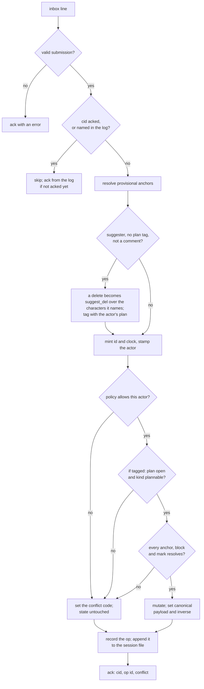
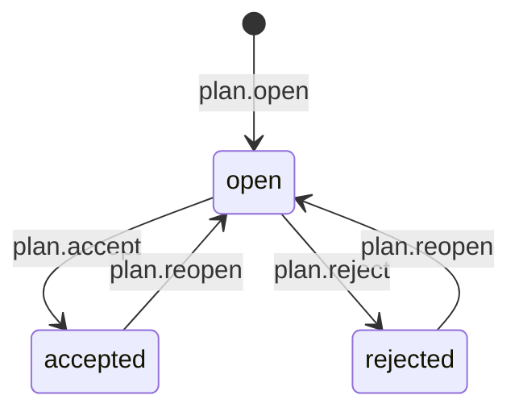

# Concurrency and version control

Three parties edit one document: a person, a coding agent, and codoc's loop. This file
says who may write, in what order ops apply, what happens when two writes meet, how a
suggestion becomes text, and how the log lives in git. The state and the ops themselves
are defined in [model.md](model.md).

## 1. Processes

One process applies ops at a time. It is called the applier.

| process | inbox name | how it writes |
|---|---|---|
| the daemon (`codoc watch`) | | It is the applier. It also runs the loop. |
| the editor host | `ide` | Appends submissions to its inbox file. |
| the CLI | `cli` | Inbox when a daemon is alive; applies directly when none is. |
| the MCP server (the coding agent) | `agent-<CODOC_AGENT>` | Same as the CLI. |
| the hub, per signed-in user | `hub-<login>` | Appends submissions to that user's inbox file. |

- A daemon is alive while it holds an exclusive `flock` on `.codoc/watch.pid`
  (`daemon/pidfile.py`). It takes the lock when it starts and keeps it until it exits;
  the OS releases it however the process ends. The file also holds the daemon's pid, for
  a person to read, but liveness never depends on it: a file left by a killed daemon, or
  naming a pid another program has since been given, reads as no daemon. The file is
  never removed, since a daemon that removed it as it exited could leave one starting at
  that moment holding the lock on a file no longer at the path. A second daemon cannot
  take the lock and exits with status 3, having written nothing.
- The editor host cannot take a `flock`, so it reads the pid as a hint: a daemon runs
  while that process exists and its command line is a `codoc watch`
  (`vscode-codoc/src/host/pidfile.ts`). The hint decides only what the status bar says
  and whether to spawn a daemon; one spawned beside a live daemon finds the lock held and
  exits with status 3.
- A daemon takes the lock before it writes anything, then builds its store under the
  applier lock. A daemonless writer applying at that moment finishes first, and its log
  is read. A writer that saw no daemon and got the applier lock after the daemon
  took its lock checks for a daemon again under the applier lock and submits through the
  inbox instead.
- Every client submission, applied directly or drained from an inbox, goes through
  `Workspace.apply_submission`: what a client may assert, how a suggester's edit becomes
  a plan, and what an amend or an ingest answers are decided there.
- With a daemon alive, no other process applies. A writer appends to
  `.codoc/inbox/<client>.jsonl` and reads the answer from `.codoc/inbox/<client>.ack.jsonl`.
- With no daemon, a writer is the applier for one call. It takes an exclusive lock on
  `.codoc/applier.lock`. If `HEAD` moved since its last turn, or git took its session
  file, it starts a new session and rebuilds, as the daemon does (section 5); otherwise
  it rebuilds only if a log file other than its own session's appeared, vanished or
  changed. Then it applies, publishes the derived files, and releases the lock.
- The lock is held per call. Held for the life of a process, it would leave every other
  writer submitting to an inbox that no daemon drains. `codoc translate`,
  `codoc rebuild` and `codoc sync` hold it for their whole run (a sync builds its store
  inside it and holds it across its model calls) and refuse while a daemon is alive.
- A long-lived writer with no daemon (the MCP server) keeps one store and one session
  file across calls. Its reads also rebuild when another process's log file changed.
  When a daemon appears, it closes its session and submits through the inbox.
- With no daemon, every MCP write of a Claude Code turn lands while the turn's agent
  epoch is open, so none settles, and nothing applies after the Stop hook closes the
  epoch. So the Stop hook, when something is queued and no daemon is alive, starts a
  detached `python -m codoc.daemon.client <.codoc>`. It takes the lock, settles
  (section 10) unless the next turn has reopened the epoch, publishes, and exits. The
  hook does not wait for it.

## 2. Files

```
.codoc/
  config.json                  tracked    doc_language, roles, index_exclude
  log/<session>.jsonl          tracked    the op log, one file per session
  log/snapshot-<hlc>.jsonl     tracked    a folded prefix of the log
  log/archive/                 tracked    files a snapshot folded
  inbox/<client>.jsonl         ignored    submissions, client to applier
  inbox/<client>.ack.jsonl     ignored    answers, applier to client
  inbox/offsets.json           ignored    how far each inbox file has been drained
  tree.codoc, projection.json, history.json, status.json, realize.md    ignored    derived
  activity.json, watch.pid, applier.lock                      ignored    local state
```

A session file:

```
{"header": 1, "session": "s-3f9a…", "opened": <HLC>}
{"id": "s-3f9a…:1", "at": <HLC>, "actor": …, "kind": …, "target": …, "payload": …, …, "sub": ["ide", "k1"]}
…
```

- One op per line, as recorded: canonical payload, inverse, conflict.
- An op minted while applying a client submission names it: `sub: [client, cid]`
  (section 4, Exactly once). Ops the applier writes on its own account around a
  submission (opening the plan a write rides in, taking back a plan nothing landed
  under) carry none.
- The file is created by the session's first op. A session that writes nothing leaves no file.
- Each op is flushed when written and the file is synced once per batch.

A file is checked when it is read:

| check | on failure |
|---|---|
| The first line is a header with a `session`. | The file is reported and skipped whole. |
| Every id is `<session>:<seq>` and `seq` runs 1, 2, 3, … | Reported and skipped whole. |
| Every `at` is a well-formed HLC and never decreases. | Reported and skipped whole. |
| Every line parses as JSON. | Reported and skipped whole, unless only the last line is unreadable. |
| Every line that parses is an op. | Reported and skipped whole. A line that parses was written whole, so it is never cut. |
| The last line does not parse (a crash mid-write). | The lines before it are kept. The daemon cuts the torn line at its next start. |

A partial read is never used: it would put the store in a state no log describes.

## 3. Clock

`HLC := "<wall ms, 20 digits>-<logical, 20 digits>-<node>"`. String order is the total order.
The node is the writer's session id, which is unique per writer and names no machine.

- `tick`: when the wall clock is ahead of the last stamp, take it with logical 0;
  otherwise keep the wall part and add 1 to the logical part.
- `observe(stamp)`: move forward to any stamp seen during replay.
- Only the applier stamps `at`. A submission carries none.
- A peer's fast clock therefore moves this clock forward. An op written after a pull is
  later than every character it can anchor to.

## 4. A submission's path

A submission is one JSON line:

```
{ cid, kind, target, payload, batch?, plan?, base?, caused_by?, at }
```

`cid` is the client's own id for it. `kind` is an op kind, or `ingest` with
`target: {bid, path}` and `payload: {base_text, new_md}`. `at` is the wall-clock time of
the append in milliseconds, stamped by the writer (`inbox.submit`, the editor host; the hub
stamps its users' lines itself). A client appends a batch with one write, so concurrent
writers interleave whole lines.

The inbox file name decides the actor:

| inbox file | actor |
|---|---|
| `ide.jsonl`, `cli.jsonl` | the local person: `human:<git config user.email>` (section 5) |
| `agent-<name>.jsonl` | `agent:<name>`; the MCP server writes `agent-<CODOC_AGENT>`, `agent-claude-code` when unset |
| `hub-<login>.jsonl` | `human:gh:<login>` |
| any other name | not drained; the daemon logs one warning naming the file |

An `mcp.jsonl` was written by an MCP server from before the `agent-<name>` inboxes. Its
lines are never applied; restart the agent so it runs the current server.

The `gh:` prefix keeps a GitHub login named `local` or `import` from arriving as the
maintainer's identity.

**Order.** The drain reads the complete lines of every inbox after its remembered byte
offset (an unterminated last line waits for the next drain) and applies them in the order
they were appended: every client of a checkout appends on one machine, the hub included,
so their `at` stamps share one clock, and the files are merged by `at`, each keeping its
own line order. A person's edit queued a moment before an agent's amend of the same words
is therefore applied first, and the machine gate sees it.

The drain, per line:

1. A line that is not a valid submission is acked with an error.
2. A `cid` already acked is skipped: no op, no second ack.
3. A `cid` the logs name in a `sub` and the ack file does not is acked from the log (the
   first op it names) and not applied again: the applier stopped between logging it and
   acking it.
4. `caused_by` is dropped unless the actor is a machine.
5. Provisional anchors are resolved (below).
6. For an actor with the `suggest` role and no plan tag: a range `text.delete` becomes a
   `suggest_del` mark over the same range, unless every character in the range was minted
   by an open plan of that actor. Any plannable op that is not part of a comment is then
   tagged with a plan of that actor, opened or reused by the drain (section 9).
7. An `ingest` runs the diff in the applier and goes through the machine gate
   (section 7). Any other kind is minted (next `seq`, `tick`, actor) and applied.
8. The recorded op is appended to the session file, naming the submission (`sub`).
9. The ack is written: `{cid, op, conflict}`. For an ingest, `op` is the first op it
   minted, `conflict` is the refusal if there was one, and `status: "unchanged"` marks a
   write that asked for nothing.

After the lines, every plan the drain opened that has no ops is withdrawn and the offsets
move past every line read. A submission that raises is acked `refused: …` and the drain
continues with the next line.



**Provisional anchors.** A client cannot know the op id of characters it sent a moment
ago. It may name them as `["$cid", "<cid>", k]`: the `k`-th character of the insert it
submitted as `cid`. The drain resolves these against the acks it has given that client.
`k` is the client's index into the text it sent; the applier stores NFC, so the index is
mapped through the normalisation. An anchor that does not resolve is left as it is and
the op conflicts `bad_anchor`.

**Idempotency.** An acked `cid` is never applied twice, and neither is one the logs
name. Ack files are trimmed to their newest 2000 lines when a session opens, and
`offsets.json` keeps the applier from re-reading lines it has drained.

**The daemon's batch.** File events are debounced (600 ms). A batch starts on a change to
a code file the index reads, to `activity.json`, to a client's `inbox/<client>.jsonl`, to
a file in `log/` other than the daemon's own session file, or to its own session file
when git took or replaced it (`git stash -u`, `git clean`, a `stash pop` that puts it
back). It never starts on the daemon's own writes (its appends to its session file, acks,
`offsets.json`), so a batch does not start the next. 30 seconds after the last batch, a
batch runs anyway (`TICK_MS`), however many files that start none changed meanwhile, so
the close of a stale agent epoch and an auto-realize retry do not wait for an edit. The
daemon takes every file event and filters it itself: watchfiles' timeout runs out only
when no event at all arrives, so a filter inside watchfiles would let a log or a build's
output that keeps changing hold the tick off. A batch that did nothing prints nothing.
For each batch the daemon does, in order:

1. Follow the logs on disk (section 5). If `HEAD` moved (its commit or its branch), or
   git took the session file: start a new session and rebuild the store from the log
   files now on disk. If another log file appeared, vanished or changed: rebuild. Note the
   hand-offs that the commits in `old..new` name in a `Codoc-Handoff` trailer, each from
   a commit whose `Codoc-Base` trailer names the branch `HEAD` is on now. The commit and
   the branch are read in one git call. A merge, a pull with or without rebase, and a
   checkout of the base count the commit; a checkout or a pull of a hub pull request's
   own branch, and a detached `HEAD`, note none.
2. Reload the roles from `config.json`, then drain every inbox from its saved offset.
   This runs on every batch, including the first one at startup and `codoc sync`, so
   submissions written while no daemon ran are applied.
3. Read the agent epoch from `activity.json`, every batch, so a daemon started during a
   turn knows it. While a coding agent's session is open, changed code files are
   deferred. When it closes, or after 900 seconds of silence (the daemon then closes it),
   the deferred files and every file the session touched go to step 4, and that pass
   cites every queued hand-off. A close is an epoch the daemon saw open that is open no
   longer, or a closed epoch whose `ended_at` is not the last close reflected, which the
   daemon never saw open: a turn can open and close while one batch runs, or while no
   daemon runs (the Stop hook reflects no code). After the pass, the daemon records the
   close's `ended_at` as `reflected` in `activity.json`, and a daemon starts from that
   record, so a close is reflected once: a daemon that starts after a turn closed with
   none running reflects that turn, and one that starts after a reflected close does not
   reflect it again, so the code changed since (a hand edit, a `git pull`) cites nothing.
   Every epoch has an id, and only a stop naming it closes it: a realize pass that runs
   no hooks opens one under its own id and closes it when the pass ends.
4. Reflect the changed code files that are not deferred: the loop's pass, which writes
   ops as `loop` and cites the hand-offs step 1 noted. It covers every code file changed
   since the index was last updated, not only those the batch saw change, so an edit
   made while no daemon ran is reflected by the next pass. The pass updates the index
   before its model call, so it writes the change set it read, and the hand-offs whose
   trailers it cites (`landed`), to `cache/pending.json` before the call and deletes the
   file once it has applied. A file this codoc cannot read counts as empty. A pass that was stopped
   (the editor's or the hub's `SIGTERM`, a kill) leaves the file. A batch that finds
   it runs the pass even when no code file changed, so the next daemon's startup batch,
   or its next tick, applies it; while an agent session is open it waits, as changed
   code does, for the pass the close runs. That pass merges the file into its own
   change set: per chunk the newer change wins, except that a chunk added since the
   last finished pass stays added. The stopped pass may have refreshed bindings before
   its model call, so the model judges every bound chunk the file names. A pass that
   raises an error deletes the file, so a change set that breaks the pass is reported
   once, not on every pass after it. Limit: a pass stopped while the index is being
   updated, before the file is written, loses what that update indexed.
5. Unless an agent epoch is open, settle hand-offs (section 10).
6. Publish the derived files.

**Exactly once.** Every writer mints random client ids (a per-page prefix in the editor, a
uuid in the CLI and the MCP server), and the drain reads each inbox line once, from the
offset it stored. A `cid` is read again if a client appends the same line again, and the
newest 2000 acks per client are kept to answer that with the same op. It is also read
again when the applier stopped (a signal, a kill, a crash) after logging a submission's
ops and before writing its ack or the offset: the logged ops name the submission
(`sub`), so it is acked from the log and nothing is applied again. The next writing
workspace to open (a daemon's, a daemonless writer's, the one `codoc snapshot` folds
with) does this for every undrained line before anything else, so a fold that archives
the log naming a submission never loses the answer. A submission whose ops were not all
logged when the applier stopped keeps the ones that were.

## 5. Sessions

- A session is one applier's run between rotations. Its id is random.
- One session file has one writer and many actors: the person, the loop and the agents
  appear in it in the order they wrote.
- The store is a function of the logs on disk. Before it applies anything, the applier
  (the daemon, or a writer with no daemon) compares them with what it loaded
  (`Workspace.follow_disk`). It closes its session, opens a new one and rebuilds when:
  - `HEAD` moved: its commit or its branch (a commit, a checkout, a pull, a rebase,
    `checkout -b`). A commit may have recorded the session file, and a checkout changes
    which files are on disk.
  - The session file is gone or replaced: `git stash -u`, `git clean`, VS Code's
    "Discard All Changes", a checkout that removed it, a fold that archived it. The
    person took those edits out of the working tree, so the store follows; words typed
    after it land in the new file. A submission anchored on characters that went with
    the file conflicts `unknown_anchor`.
- It rebuilds, keeping its session, when a log file other than its own appeared,
  vanished or changed: another writer applied, or git brought a file back or took one
  without moving `HEAD` (`git stash pop`). The restored words reach the editor at that
  batch, so nobody types them twice.
- All of this is checked at the start of each daemon batch and each daemonless call,
  before anything applies; a change in `log/` alone starts a daemon batch. A commit made
  while a long pass runs (a reflect pass waiting on a model) is seen at the next batch,
  so that pass's ops still go to the file the commit may have recorded. The next commit
  records them; a merge of two branches is unaffected, because each branch's files are
  its own.
- A read-only open replays the logs and writes nothing.

**Actors.** The local person is `human:<email>`, the `git config user.email` of the
repository, read once per process (`inbox.local_actor`); `human:local` only when there is no
git or no email. The CLI, the daemon, the VS Code host and the editor page all get it from
there: the daemon writes it to `status.json` as `actor`. So two people sharing the log
through git are two actors: one's unsent words are not inked as the other's, and one's
batches are not in the other's ⌘Z. A hand-off is still per feature: it covers every
person's words in it. The email lands in the tracked session logs, as it does in git
commits. Logs written before this carry `human:local`.

## 6. Replay

The store is rebuilt from the files on disk. The order is:

1. Read every session file in `log/`. Skip each invalid file whole.
2. If there is a snapshot, replay the newest one first, then add its frontier to the
   store's frontier.
3. Replay every op of the session files that is outside the snapshot's frontier, sorted
   by `(at, session, seq)`.

Each op replays as its record says:

- An op recorded with a conflict is recorded again with that conflict and applied not at all.
- An op recorded as applied is applied from its canonical payload, with the authority
  check off. Its inverse is computed again, never read from the record; an op recorded
  without one gets none.
- An op recorded as applied that conflicts now is stored with the new conflict and
  reported as a problem. `codoc rebuild` and the daemon print the problems.
- The clock observes every `at`.

Given the same set of files the rebuild is the same on every machine. Op ids do not
change, so every anchor, frontier and plan subset recorded before a merge names the
same thing after it.

## 7. Roles and authority

The role table is `roles: {actor: role}` in the tracked `config.json`, so every clone
reads the same one. An actor's role is, first match:

1. Its entry in the table, `none` included.
2. `machine`, when the actor's kind is `agent`, `translator`, `loop` or `import`.
3. `owner`, when the actor is a git person: `human:<email>` or `human:local` (section 5).
4. `suggest`: a hub sign-in (`human:gh:<login>`) and any other actor.

A git person is an owner because they can already push to the repository, and trust in a
merged log comes from who may push (Foreign logs, below). So a teammate's pushed trunk
edits apply on every clone, and `codoc rebuild` and `codoc validate-logs` do not report
them. What this trusts is the actor a log line names, which nothing signs: anyone whose
log reaches the trunk can write as any `human:<email>`, as they already could as
`human:local`. A reviewer who merges a pull request vouches for its logs as for its code.
To hold a git person to less, give them an entry (`suggest`, or `none`). A hub sign-in is
not trusted this way: the server assigns its actor, and the table holds what the hub
recorded for it.

| role | may write |
|---|---|
| `owner`, `maintainer` | Everything. |
| `machine` | Every op, untagged or tagged with any open plan, except the verdict kinds: `plan.accept`, `plan.reject`, `plan.reopen`, `feature.handoff`, `feature.realized`. Two exceptions: `loop` may write `feature.realized`; a machine may reject its own open plan that has no ops. |
| `suggest` | `plan.open`. Ops tagged with a plan the same actor opened. Comments, as below. A reject of its own open plan that has no ops. Nothing else. |
| `none` | Nothing. The hub records it when access is revoked. |

A suggester's comment ops, all untagged:

| op | allowed when |
|---|---|
| `block.add` of a `comment` block | Always. A reply is a new block. |
| `text.mark` of kind `comment` | Always. It is the anchor on the prose. |
| Text ops and `block.set` on a comment block | The actor added that block. |
| `block.set` of `status` on a comment block | The actor added the thread's first block, which `thread` names. |

- A suggester's `block.merge` or `block.delete` cannot ride in a plan, so it is refused.
- The check runs once, when the op arrives, and the answer is recorded on the op: a
  refused op is stored with `conflict: "authority"`.
- Replay does not ask again. A role changed later never removes what someone already
  wrote, and the rebuild is the same whatever the table says today.
- The policy reads the plans and, for comments, who added a block. It does not read the
  rest of the document, so a log can be checked without the document it was written against.
- The hub writes `human:gh:<login>` into the table when a user signs in, as `maintainer`,
  `suggest` or `none`, from their GitHub permission on the repository, and again when a
  periodic re-check finds that permission changed (`serve/auth.py`, `record_role`). The
  table is in the tracked `config.json`, so a first sign-in adds a person to it and leaves
  the file modified for the maintainer to commit; the hub writes only the `roles` key.

**Foreign logs.** Because replay trusts the record, a log file is a capability: a file
edited to remove the conflict from a refused verdict would apply on every clone that
rebuilds. `codoc validate-logs` checks the session files a merge would add or change
(`git diff <base>...HEAD`, files under `.codoc/log/`) and reports:

| finding | why |
|---|---|
| An op recorded as applied that the role table would refuse. A withdrawal of the actor's own empty plan is judged on every op tagged with that plan that a writer recorded as applied, at any clock, read from the merge base's session files and the files under check. | A forged or unauthorised write; the applier refuses every tagged op after a withdrawal, so a backdated reject gains nothing. |
| A session file whose merge-base version, up to its last whole line, is not a prefix of it. | A session file is only appended to; one that edits a recorded answer forges it. The base version is the record. A torn last line does not count, since a daemon that starts cuts it. |
| A session file the merge removes, or moves (into `archive/` too). | Replay would lose the answers it records, a verdict among them. Only a fold archives files, and a snapshot file is already a finding. |
| A snapshot file. | It states a whole state; only the workspace that folds its own log may write one. |
| An op carrying a field only a snapshot writes (`ops.SNAPSHOT_ONLY`: a block's texts and death, a plan's ops, a folded verdict's `verdict`). | It would claim another actor's words or a decision nobody made. |
| A stamp more than 24 hours ahead of this machine's clock. | It would pull every clock that observes it into the future. |
| An op recorded as applied under a plan after that plan's verdict (by clock, with no reopen between). | The applier refuses it with `plan_not_open`; a log that drops the conflict would put words into a decided plan. |
| Any failure of the read checks in section 2. | |

A verdict's `steps` need no finding: replay computes them again from the plan and
never reads the recorded ones (section 9).

What the door cannot check is who wrote an op: an op's actor is whatever the file
says, and nothing signs it. A pull request can claim any actor, so the role table
guards only what that actor may write. Trust in a merged log comes from who may push to
the repository; on the hub, the server assigns each signed-in person's actor itself.

`codoc rebuild` prints, per actor, how many applied ops in the local store the table
would refuse today. That is a signal and changes nothing. It judges a withdrawal by the
rule above, against its plan as it stood when the reject was written, so a machine taking
back its own empty plan is not counted.

### The machine gate

A machine that writes new text for an existing field does it through `ingest`
([model.md](model.md#6-content-as-ops)). When no plan was given, the applier decides
where the write lands:

| condition, first match | outcome |
|---|---|
| The content was read off the code (a derived diagram redrawn by the loop). | Trunk. The gate is skipped. |
| The trunk refuses it because it would drop a mark a person placed. | A plan. |
| The write changes nothing. | Nothing. |
| The feature's phase is `edited`, `queued` or `planned`. | A plan. The document wins. |
| The writer is a translator. | A plan when a person wrote any live word of the block, else trunk. A translation replaces every word, so `deleted_fraction` says nothing. |
| `deleted_fraction` is above 0.15 and a person wrote any live word of the block. | A plan. |
| `deleted_fraction` is above 0.5. | A plan. |
| Otherwise. | Trunk. |

The plan is opened as the machine's own `edit` plan on that block, or reused (section 9).

A repair of several blocks (an `amend`: rewordings, new blocks, removals, kind changes)
gets one decision for all of it (`Workspace.amend`, reached by the loop directly and by
an agent through the `amend` submission):

| condition, first match | outcome |
|---|---|
| A rewritten block holds words an open plan inserted. | That block is refused (`open_plan`); answer the plan first. |
| The amend adds, removes or re-kinds a block, or the feature is `edited`, `queued` or `planned`. | One plan for the whole amend. |
| Any rewording meets a plan row of the table above. | One plan for the whole amend. |
| Otherwise. | Every part on the trunk. |

An agent's plan (`codoc_propose`, or a `codoc_reflect` edit that needs one) is one
`propose` submission, decided whole by `Workspace.propose`: it opens the plan, writes the
new blocks, rewordings and strikes under it, and takes the plan back when nothing landed.
A delete plan stays with nothing under it, since accepting it is the deletion. The agent
mints the plan id, so it knows the id even when the ack comes late, and a late ack never
leaves an empty plan behind.

A client's mark that names its placer (`actor`, `op`, `at`) keeps that placer only when it
repeats the inverse the applier recorded for the sender's own latest change of that mark
kind on that field: the undo of a removal. An undo resent after someone else changed the
mark is the sender's own mark.

## 8. Conflicts

No write is merged by guessing. An op either applies or is recorded with a code
([model.md](model.md#conflict-codes)), and the client learns the code from the ack.

| situation | outcome |
|---|---|
| Two inserts after the same character. | Both apply. The one applied later sits nearer the anchor. |
| An insert after a character someone deleted. | Applies at the dead character's place. |
| A delete of characters someone already deleted. | Those characters are skipped. |
| A text op while someone split or merged the block. | Applies. The character is found in whichever block holds it now. |
| A range delete or mark whose ends are now in different blocks. | `range_spans_blocks`. The client reads again and sends one op per block. |
| A text op in a block someone deleted. | `dead_block`. |
| An anchor naming a character this store has not applied. | `unknown_anchor`. |
| An `ingest` computed against text that has changed. | Refused `stale_base`. No op is minted. The caller reads again. |
| Two blocks added with the same rank (two clones each appended after the same block). | Both apply. The one applied later sorts immediately before the other. |
| `block.add` or `block.split` with an id that exists. | `duplicate_block`. |
| `block.merge` when the two blocks are no longer neighbours. | `not_adjacent`. |
| `bind.attach` of a symbol another feature owns. | Applies. The other feature loses the symbol, and the op records it. |
| An op tagged with a plan that has been decided. | `plan_not_open`. |
| A second verdict on a plan. | `plan_not_open`. |
| The undo of a verdict after someone reopened and decided the plan again. | `not_current_verdict`. |
| The undo of a verdict a snapshot folded. | `verdict_folded`. |
| A machine repair to a feature with pending intent. | It becomes a plan (section 7). |
| An actor whose role no longer allows a write. | Earlier ops stand. New ones conflict `authority`. |
| A suggester's `block.merge` or `block.delete`. | `authority`. Every other edit of theirs becomes a plan. |
| One op of a batch conflicts. | The rest of the batch still applies. |
| After a git merge, an op that applied on its branch does not apply on the merged state. | The op with the earlier `at` applied first and stands. The later one is stored with its conflict and reported. |

## 9. Plans and verdicts



- Every role except `none` may open a plan. Only `owner` and `maintainer` may give a
  verdict. `plan.reopen` reaches the log only as the undo of a verdict.
- A plan's ops apply to the document at once, tagged. The read mode decides whether a
  reader sees them ([model.md](model.md#read-modes)).
- A plan proposes and never destroys. It may not carry `block.delete` or `block.merge`.
  It asks for words to go with `suggest_del`, and for a feature to go with `kind = delete`.
- What an owner or maintainer types inside proposed words is untagged. No verdict removes it.

What each tagged op becomes:

| tagged op | while open | on accept | on reject |
|---|---|---|---|
| `text.insert` | A live segment carrying the plan. | Stays. The tag stays as provenance. | Its characters die, wherever a split or merge has moved them. |
| `text.mark` of `suggest_del` | A mark recording which characters to cut. | Exactly those characters die. The mark is removed. | The mark is removed. |
| `text.mark` of any other kind | A `suggest_mark` record. The document's marks are unchanged. | The toggle is applied to the document under the proposer's actor and op. The record is removed. | The record is removed. |
| `text.delete`, `text.restore` | Act on the plan's own words only. | Stay. | A delete's words come back; a restore's go back to dead by the delete it undid. |
| `block.add`, `block.split` | The block exists. | Stays. | The block dies if it holds no live text. |
| `block.set` | Applied. | Stays. | The previous value returns, or the field is absent again. A heading the plan made prose takes back the code it lost; a block the plan made a heading loses the code bound to it since. |
| `block.move` | Applied. | Stays. | Each block's previous rank, level and `ranked_by` return, while the move is still the op that ranked it. Otherwise the later move stands. |
| `bind.attach` | Applied. | Stays. | The symbol returns to the owner it displaced, or is unbound, unless someone re-bound it since. |

`plan.accept`, in order:

1. The plan must be open.
2. The accepted set is every applied op of the plan. With a `subset`, it is the subset
   plus every plan op that minted an anchor an accepted op uses or created the block an
   accepted op lives in. `subset` is the decision; nothing else in the payload is read.
3. The `suggest_del` marks of accepted ops are resolved before anything is mutated.
4. Plan ops outside the accepted set are undone, newest first, as a reject would.
5. Each resolved `suggest_del` kills its recorded characters and is removed.
6. Each accepted `suggest_mark` record is applied, in the order the records were placed.
   A record asking to turn off a whole mark that is already gone is dropped as satisfied.
7. For `kind = delete` with a live target: the heading's body dies and its bindings are detached.
8. The plan is `accepted`, `decided_by` is the actor and `verdict` is this op.

`plan.reject` is steps 1, 4 and 8 with an empty accepted set: it undoes every applied op
of the plan, newest first.

**Steps.** A verdict records every change it made as an ordered list, `steps`. The list
is the applier's record and is never read from a payload: a verdict computes it from
its decision and the plan's ops each time it applies, a replay included. A log edited to
add steps to a verdict therefore changes nothing on a rebuild, and a machine's withdrawal
of its own empty plan does nothing whatever it carries. A step names what it changed by
identity and carries what it replaced, so undoing it needs the step alone. A step that
changed nothing is not recorded.

| `do` | fields | did | undone |
|---|---|---|---|
| `kill` | `bid`, `path`, `segments`; `by`, `actor`, `at` when it put back another op's kill | The characters die, by the op that recorded the step unless `by` says otherwise. | They live again, those still dead by that killer. |
| `revive` | `bid`, `path`, `segments`, `by`, `actor`, `at` | The characters `by` had killed live again. | They die again, by `by`, with its actor and clock. |
| `mark` | `bid`, `path`, `mark` (with its `actor`, `op`, `at`), `on`, `segments` | That mark was added (`on`) or removed; `segments` are the characters it covered. | Removed: every mark equal to it but for its range whose first character is one of `segments`, in every field holding them. Added: one piece per field holding any of `segments`, from the first of them to the last. |
| `set` | `bid`, `from`, `to`; for `kind`, `bindings`, `detached`, `attached` | `kind`, `level`, `rank` with `ranked_by`, or content fields went from `from` to `to`. A content field missing from one side was absent there. A `kind` change is a feature leaving or coming back as `block.set` has it: leaving, its bindings came off (`detached`); coming back, it took back `bindings`, what the plan's op detached (`attached`). | `from` again; for `rank`, only while `ranked_by` is still the one in `to`. For `kind`, the same rule the other way: the code bound since comes off, or `detached` comes back. On a block that has died since, it is kept on the block as a delete keeps it (recorded as `attached`), and the block's restore re-attaches it. |
| `void` | `bid`, `op`, `to` | The move `op` could not be put back, and `to` is the place it found the block, kept in the block's `void`. | It is dropped from `void`. |
| `kill_block` | `bid`, `in`? | The block died by the op that recorded the step, while in feature `in`. | It lives again, if that op is still its killer. |
| `bind` | `symbol`, `from`, `to` | The binding went from `from` to `to`; `null` is unbound. A `to` that is not a live heading now is `null`. | `from` again, unless it is not a live heading now. |
| `detach` | `fid`, `bindings` | The dead heading's bindings were removed and kept on it. | Each is re-attached unless the symbol has an owner now. |

A `mark` step finds its mark by the characters it covered, so a split that cut the mark
in two, a merge or a move since does not stop the undo.

`plan.reopen` reads only `by`. It must name the plan's current verdict, or it conflicts
`not_current_verdict`: an undo of an earlier verdict that arrives after someone reopened
and decided the plan again changes nothing. It undoes the steps the store recorded on
that verdict, newest first, wherever the characters and blocks are now, dead blocks
included, and records them as it undid them, a `set` or `bind` with the value it
displaced as `to`. Its inverse is the verdict's decision again: `plan.accept` with the
same `subset`, or `plan.reject`. A redo is therefore judged against the plan as it is
then, so words the plan gained or took back after the reopen, and a paragraph written
under a heading a delete plan removes, are decided with the rest.

A move a plan made is put back only while it is still the op that ranked the block,
the block's `ranked_by`. A rank string says nothing about who gave it: two blocks placed in
the same gap at different times get the same one, and a rank already held is moved to a
free one. Every rank write sets `ranked_by`, and a move records each block's previous
rank, level and `ranked_by`, so undoing it, by ⌘Z or by a verdict, restores all three. A
drag undone with ⌘Z therefore does not count as a move since. A plan that moved a block
twice is undone newest first, and undoing the second move makes the first the block's
`ranked_by` again, so the first is undone too; a move someone else made between the two
stands. A reopen undoes a `set` step's rank only while `ranked_by` is still the one the
step set: a move made since stands, and so it does when the verdict is redone.

A rejected plan's move that cannot be put back is recorded as a `void` step: its place
is kept in the block's `void`. Every undo of a move, a verdict's or a person's, that
would give the block back a void move's place goes on to the place that move found the
block. Of two plans P and Q that moved the same block, P first, rejecting P first finds
Q's move on the block and voids P's; rejecting Q then puts the block back where it was
before P. Both rejected leave it where neither put it. A reopen drops the void its verdict
recorded. Nothing here reads the log, so a fold changes no later verdict.

A reader finds the trunk marks a verdict removed or added as its `mark` steps: `on` true
for added, false for removed, each with the placer's `op`. The `suggest_del` marks
and `suggest_mark` records it dropped are `mark` steps too. A reopen's `mark`
steps are the ones it undid, so there `on` true means it removed that mark.

**A folded verdict is not reopened.** The undo of a verdict a snapshot folded conflicts
`verdict_folded` and changes nothing. The fold archived the verdict's steps and the
plan's ops, and any verdict after the reopen, its redo included, would have to judge
those ops. A plan whose verdict or reopen comes after the cut is not folded, and the
verdict a fold writes carries no inverse (section 12), so this happens only to an undo
taken before `codoc snapshot` and sent after it, a branch forked before the fold
included.

- **The applier never adds a hand-off to a verdict; the sender does.** The editor's
  Accept and `codoc accept` send `feature.handoff` in the same batch for the features
  `derive.accept_handoffs` names: those a plan opened with `build` touches.
  `codoc_propose` sets `build`, since its plan comes before the code and is a request to
  build. A plan from `codoc_reflect`, the loop, a translator or a suggester describes
  words or code that already exists and is accepted without a hand-off. The mark is on
  the plan, so a snapshot keeps it. `codoc accept --build` hands off any
  plan's features, `--no-build` none. A delete plan is never handed off with its
  accept; removing code is `codoc handoff --delete-code`.
- **Plans the applier opens.** A suggester's untagged edit, and a machine write the gate
  demoted, need a plan. The applier uses, first match: the plan it opened for the same
  actor and batch, if still open; the newest open `edit` plan of that actor targeting the
  same block; a new `edit` plan targeting the block. A sentence typed over several
  flushes is therefore one plan.
- **Empty plans are withdrawn.** When a plan the applier opened ends with no ops, the
  applier rejects it as the plan's own actor.
- **A plan with nothing on the page is not offered.** A plan whose target is dead is
  offered while words, `suggest_del` marks or `suggest_mark` records of it are still
  live on a live block, since the editor draws them and the person must be able to
  decide them. Once nothing of it is left on the page it stays open but is not offered;
  if its target is restored, it is offered again.
- **An open plan stops a snapshot** at the oldest op of the feature it is on (section 12).

### Example: a plan

Paragraph `b-1` holds one segment `(s1:4, 0, "Retries once.")` by `human:local`. The agent
proposes `Retries **three times**.` under a plan:

| op | actor | plan | what it does |
|---|---|---|---|
| `s1:8` `plan.open` | `agent:claude-code` | | Opens `p-1`, `kind: edit`, `target: b-1`. |
| `s1:9` `text.mark` | `agent:claude-code` | `p-1` | `suggest_del` over `[s1:4, 8]..[s1:4, 11]` ("once"), with `chars: "s1:4:8,s1:4:9,s1:4:10,s1:4:11"`. |
| `s1:10` `text.insert` | `agent:claude-code` | `p-1` | `"three times"` after `[s1:4, 7]`. |
| `s1:11` `text.mark` | `agent:claude-code` | `p-1` | `bold` over `[s1:10, 0]..[s1:10, 10]`, stored as `suggest_mark {plan: p-1, mark: bold, on: "1"}`. |

Segments now: `(s1:4, 0, "Retries ")` `(s1:10, 0, "three times", plan p-1)` `(s1:4, 8, "once")` `(s1:4, 12, ".")`.

| read mode | text |
|---|---|
| `live` | `Retries three timesonce.` |
| `rejected` | `Retries once.` |
| `accepted` | `Retries **three times**.` |

`s1:12` `plan.accept` by `human:local`: `(s1:4, 8, "once")` dies by `s1:12`, the
`suggest_del` mark is removed, and the `suggest_mark` record becomes a `bold` mark placed
by `agent:claude-code` with op `s1:11`. The paragraph reads `Retries **three times**.` in
every mode. "three times" keeps `plan: p-1` and its agent author.

A `plan.reject` in its place: `(s1:10, 0, "three times")` dies and both records are
removed. The paragraph reads `Retries once.`

## 10. Hand-off and realization

- `feature.handoff` moves a feature's `handoff` frontier. It is the one gesture that
  turns documentation into a request. Only `owner` and `maintainer` may write it.
- `feature.realized` moves the `realized` frontier. It conflicts `nothing_queued` when no
  hand-off is waiting.
- The applier writes `feature.realized` as `loop`, and only on evidence: a feature
  settles once an applied binding op since its latest hand-off cites that hand-off in
  `caused_by`, on a symbol a build touched since the hand-off (its code moved or it was
  newly bound, by that op or an earlier one, `ops.built_code`; a reflect pass may take the
  change before the agent reports it). A citing op on code nothing built records a review,
  not the build. The op may bind
  any feature: the request built as a sub-feature binds the
  new node, and a request that changed a symbol another feature owns binds that owner.
  An op under a plan counts once a verdict accepted it: an open plan may
  still be rejected. Only the record decides, never the actor or the timing. The
  op may be an agent's `codoc_reflect` (any agent), the reflect pass that ran because a
  Claude Code session closed (it cites every queued hand-off), or the pass over commits
  whose `Codoc-Handoff` trailer names the hand-off and whose `Codoc-Base` trailer names
  the branch `HEAD` is on (the hub's pull requests, once merged into the branch they
  target). The daemon
  checks at the end of every batch and after every reflect pass; a daemonless writer
  checks after it applies.
- An agent's report is evidence only of code the files hold. Its `attach` is compiled
  against the code on disk, not against the index, so code the turn wrote binds before
  any pass has indexed it, with or without a daemon, for any agent. The file is read
  through the one path the indexer reads it by (`index.app.file_chunks`: decoded by its
  byte-order mark, else as UTF-8 with undecodable bytes replaced, line endings kept), and
  named as the index's walk names it (`canonical_file`: repo-relative, with `./`, `..`
  and an absolute path folded lexically; a linked file keeps its link's name; a path none
  of whose ancestors is the repository, such as one through a link from outside into a
  subdirectory (`/tmp/src -> repo/src`), is named by its real path below the root when
  the walk keys the file by that name, and refused as outside the repository otherwise).
  It is read only when the walk reads it (`why_not_indexed`, the one rule the walk and
  the daemon also follow): not under a linked or excluded directory, not excluded itself,
  at most 1.5 MB, and spelled as its directory lists it, so on a case-insensitive
  filesystem `SRC/rate.py` does not stand for `src/rate.py`. The evidence and the binding
  it is compared with are then the same text under the same key:
  - a symbol the files do not define, or one in a file the walk does not read, is
    refused with the reason, and nothing of the call is written;
  - a symbol the feature does not own is attached (`bind.attach`);
  - a symbol the feature owns is refreshed (`bind.refresh`) when its code changed since
    the hand-off: its hashes on disk differ from the binding's, or a binding op on it
    has applied since the hand-off (a reflect pass took the change before the agent
    reported it). Otherwise nothing is written: a re-attach of unchanged code is no
    evidence.
  The attach reads the disk and never writes the index, so the daemon's reflect pass
  still sees the change, and whichever lands first, the other cannot make the agent's
  report a no-op. The pass shows the model a bound chunk whose hashes an agent or a
  person set (`Binding.set_by`), even when they match the code, so the agent's report
  does not hide its change from the prose review. A plan (`codoc_propose`) reports no build, so it refreshes nothing.
- Nothing settles while an agent epoch is open (`activity.json`): the build is in
  progress, so the feature stays queued and the agent's amends land as plans. The batch
  that sees the epoch close runs the same check, so a Claude Code turn settles at its end;
  with no daemon, the Stop hook starts a process that takes `applier.lock`, runs the check
  once and exits (`client.settle_closed_epoch`).
- A deleted heading with a hand-off waiting settles when a pass that cited it saw every
  symbol the heading owned removed from the code. If the hand-off did not set
  `delete_code`, it settles on that pass alone.
- A reflect pass caused by a hand edit cites nothing and settles nothing.
- When the build moved no bound symbol, or the code was written by hand, there is no
  evidence. An owner writes `feature.realized` by hand with `codoc done`.

## 11. Git

Tracked: `config.json`, everything under `log/`, and `media/`. Everything else in
`.codoc/` is ignored, `tree.codoc` included: the daemon rewrites it on every edit, and a
tracked file it rewrites makes git refuse a pull, a checkout or a `stash pop` over the
person's uncommitted words.

- **One file per session.** Two branches whose sessions wrote different files never
  conflict in git; a merge keeps both files.
- **The daemon does not append to a committed file.** It checks `HEAD` at the start of
  every batch, before it applies anything, and starts a new session when `HEAD` has
  moved. It never writes to a file it has rotated away from, so a commit leaves no
  tracked log modified. Two branches forked from one commit do not share an open file.
- **A merge is a rebuild.** After a merge, a checkout or a pull the set of files on disk
  has changed. The daemon rebuilds when it sees `HEAD` move; `codoc rebuild` does the
  same by hand. The merged ops land by their character anchors, in the order of section 6.
- **Uncommitted words** are in an untracked session file, which a checkout, a pull and a
  stash without `-u` leave alone, as they leave uncommitted code. `stash -u`, `clean`
  and a discard take it; the daemon then rebuilds without those words (section 5).
- **Rebase and squash** keep the log files, since they are tree content. The commit id
  in `feature.realized` (`sha`) may then name a commit that is gone.
- **A pull request** from someone else carries their session files. Run
  `codoc validate-logs` before merging it (section 7).
- An uncommitted local session is the one thing by which two rebuilds of the same
  branches can differ.

### Example: two sessions after a merge

Commit `C0` holds `log/s-base.jsonl`: a paragraph `b-1` reading `Retries once.` (minted by
`s-base:4`) and a paragraph `b-2` reading `Gives up after that.` (minted by `s-base:6`).
Two branches fork from `C0`.

| branch | session | op | written at |
|---|---|---|---|
| A | `s-a` | `s-a:1` `text.insert` `" with backoff"` after `[s-base:4, 11]` | 10:00 |
| A | `s-a` | `s-a:2` `block.delete` `b-2` | 10:01 |
| B | `s-b` | `s-b:1` `text.insert` `" per request"` after `[s-base:4, 11]` | 10:05 |
| B | `s-b` | `s-b:2` `text.insert` `" point"` after `[s-base:6, 18]` | 10:06 |

After `git merge`, `log/` holds `s-base.jsonl`, `s-a.jsonl` and `s-b.jsonl`, with no git
conflict. The rebuild replays `s-base:1..6`, `s-a:1`, `s-a:2`, `s-b:1`, `s-b:2`.

- `s-a:1` and `s-b:1` share an anchor. Both apply. `s-b:1` applied later and sits nearer
  the anchor: `Retries once per request with backoff.`
- `s-a:2` applies. `b-2` is dead.
- `s-b:2` finds its anchor in a dead block and is stored with `dead_block`. The rebuild
  reports: `text.insert by human:local applied when it was written and conflicts on this
  merge (dead_block); those words are not in this tree`.

Undoing `s-a:2` (a `block.restore`) brings `b-2` back. The words of `s-b:2` were never
inserted, so the person types them again.

## 12. Snapshots

`codoc snapshot` folds the settled prefix of the log into one file. The daemon must be
stopped; the command runs under the applier lock. It refuses while an agent's turn is
open: a fold re-emits a queued hand-off under a new op id, and the turn's build, which
cites the old one and settles only when the turn ends, would never settle.

**The cut.** An open plan's verdict undoes the plan's own ops by identity, so those ops
must stay in the log. The cut is the position of the first op, in apply order, that names
any of:

- a block of a feature that has an open plan on it (the heading and its body);
- an open plan, its target, or one of its ops;
- a plan with a verdict or a reopen at or after the cut, or one of its ops. Such a plan
  was in flight across the cut, and a verdict on it judges its ops. The rule is applied
  again until the cut stops moving.

Everything before the cut is folded. Everything from the cut on stays an ordinary
session log. A tree with no open plan folds whole. When the cut is at position 0 the
command writes nothing and says so.

**The file** is `log/snapshot-<hlc>.jsonl`. Its header carries `snapshot: true` and
`frontier`, the per-session highest `seq` among the folded ops. Its ops rebuild the
store as the folded ops left it:

| op | one per | carries | actor |
|---|---|---|---|
| `block.add` | block, live or dead | `rank`, `level`, the full Text of each Text field (segments with actors, clocks and killers; marks), other fields, `added_by`, `dead`, `dead_actor`, `dead_at`, `dead_in`, `detached`, `prior`, `bound_once`, `code_at`, `realized_at`, `ranked_by`, `void` | `import` |
| `bind.attach` | binding | the hashes | `import` |
| `plan.open` | plan | `kind`, `target`, `note`, `ops`, `opened_by`, `build` | the plan's actor |
| `plan.accept` or `plan.reject` | plan | `verdict`, the op it folded; it sets the plan's status and verdict and does nothing else | the actor who decided |
| `feature.handoff` | block with a `handoff` or `realized` frontier | `covers` and `realized`, the two frontiers; `asked`, `delete_code` of the latest hand-off | that hand-off's actor; `import` when `covers` is empty |

The fold's `feature.handoff` is the one place a watermark's frontiers are restored. It
carries `realized`, a field only a snapshot writes, and with it the op sets `handoff` to
`covers` and `realized` to `realized` on the block, whatever the block's kind is now. A
watermark stays on its block through a kind change, so a hand-off whose heading was made
prose before the fold is queued again when the block is made a heading again, as it would
be without the fold. The op does not move `code_at` or `realized_at`; the `block.add`
restores both clocks. When `covers` is not empty the op becomes the block's latest
hand-off. It comes after the `bind.attach` ops, because a settle reads its evidence from
the ops after the latest hand-off.

None of these ops carries an inverse, and replay gives them none (section 6). They
re-express state and are nobody's gesture, so an undo never takes the fold's batch for
the person's last change: a re-emitted verdict's reopen would conflict `verdict_folded`
every time, and a re-emitted hand-off would be taken back. A `block.add` keeps what it
restored in its record, so a second fold, which replays the first one's records, keeps
it too.

**The archive.** A session file moves to `log/archive/` when it is valid and every op in
it is inside the frontier. Older snapshots move there too. A file that also holds ops
after the cut stays in `log/`; the frontier keeps its folded ops from applying twice. A
daemonless writer that holds an archived file open finds it gone at its next call and
opens a new session (section 5), so nothing is appended under `log/archive/`.

**What a fold keeps.** `state_fingerprint` and every view of the document are equal
before and after. A segment carries its author, its clock and its killer's; a mark
carries its placer; a watermark carries its frontiers, when the code last moved and when a
realization last settled, on any block that holds one; a dead heading carries the
bindings it owned. `history` and the timeline are views of the log and lose the folded
ops.

**A branch forked before the fold** still merges: replay applies the snapshot and then
every op outside its frontier, whatever its `at`, and the snapshot keeps dead blocks and
dead characters for those ops to anchor to.

**Two snapshots** after a merge mean two clones each folded. The one whose frontier
covers more ops is the state (a tie goes to the later file name, so every clone that
merges the same files picks the same one). The rebuild reports the other, and the session
files in `log/archive/` are replayed past the chosen frontier, so that the other clone's
folded ops are not lost. Fold once, on one branch.

## 13. The editor's side

The editor shows a projection and holds local edits that the applier has not answered.
It adopts each new projection block by block.

- A block is **held** while one of its ops is unacked, or while the projection in hand
  does not contain the last op the applier applied for it (that op is outside the
  projection's `frontier`). A held block keeps its node and its place.
- A gesture holds every block it names and every block it added or removed.
- A projection from another `store` drops the page's last-applied ops and re-reads every
  block with no op in flight; ops in flight keep their blocks held. Within
  one `store`, one whose `head` is lower than the one already shown is dropped.
- A block that is not held and whose `head` is unchanged is left alone. Any other
  unheld block is replaced by the projection's.
- An adoption that changes only words replaces those blocks in place. One that adds,
  removes or moves a block rebuilds the document.
- A conflicted ack drops the op. The block keeps its other unacked words and is
  re-adopted once none of its ops is in flight.

## Rejected

- **Rejecting a plan automatically when its target block dies.** Built and reverted. A
  delete can be undone, and restoring the heading has to bring its plans back. Such a
  plan stays open and is not offered. Keeping them costs a cold publish about 50 ms.
- **Checking authority again at replay.** A role reduced tomorrow would delete what the
  person wrote today, and the rebuild would differ with the state of the table.
- **Carrying the ops of unfinished work inside the snapshot.** The carried ops had no
  order among themselves and the archive grew with every fold. The fold stops at the cut.
- **An applier lock held for the life of a process.** The other writer would submit to an
  inbox with no daemon to drain it.
- **Adopting a projection by replacing the whole editor document.** Mapping the painted
  ranges through a whole-document replace was 5 times slower than rebuilding them.
  Replacing only the changed blocks in place took an adoption of one changed block from
  61 ms to 14 ms.
- **Computing decorations from the viewport.** ProseMirror has no height oracle, so
  finding the blocks on screen takes one `getBoundingClientRect` per block. At 3,000
  blocks a keystroke went from 7 ms to 1,230 ms. Build a height oracle first, then measure.

## Not built

- Log validation inside the hub. `codoc validate-logs` is a manual step before a merge.
- A setting to log a hash of the hand-off prompt in place of its text. The prompt and
  every actor's login are in the committed log.
- A marker op per commit, to scrub the timeline by commit.
- An exact snapshot cut. The cut is at the oldest op of a feature with an open plan,
  which can be earlier than the oldest op the verdict needs.
- Ranks from writers other than codoc's clients. `rank.valid` refuses a pinned rank that
  `rank.between` cannot produce (for example one ending in the zero digit), so a block
  added with such a rank is a `malformed` conflict.

